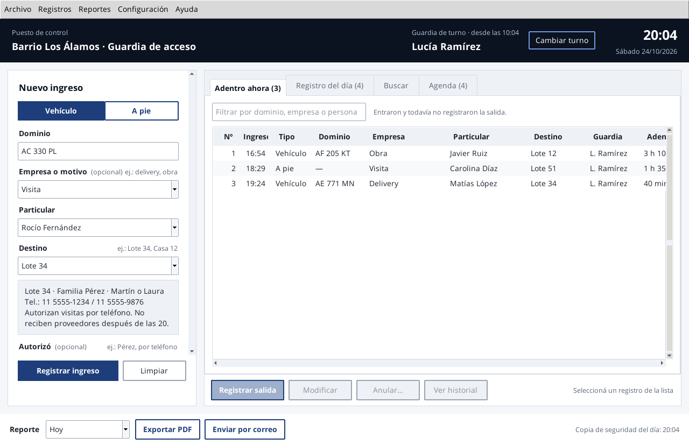
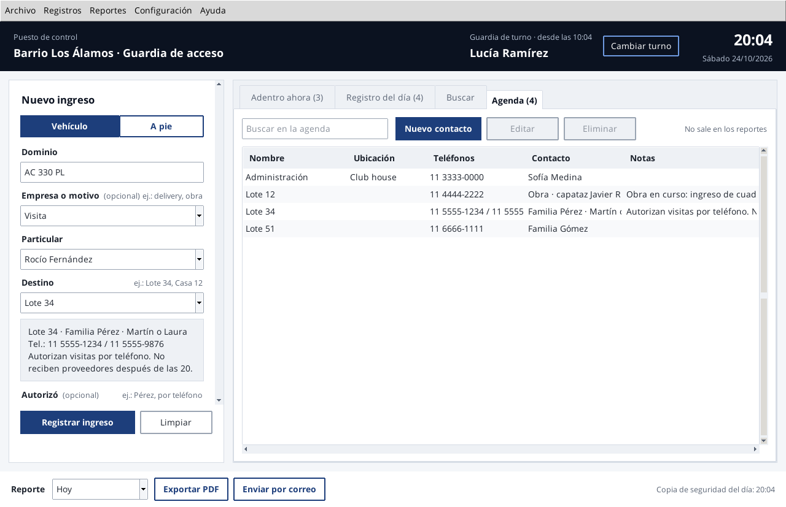
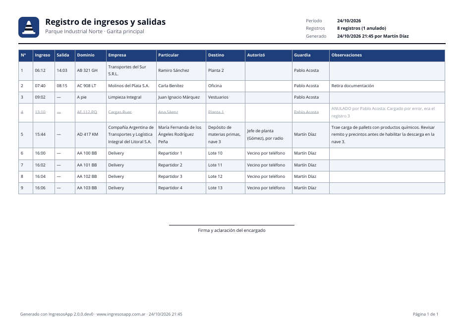

<p align="center"></p>

<h1 align="center">IngresosApp</h1>

<p align="center">
Registro de ingresos y salidas para la guardia de barrios cerrados, parques industriales y otros predios privados.<br>
<a href="https://www.ingresosapp.com.ar/">www.ingresosapp.com.ar</a> · <a href="https://github.com/Lucas68747/IngresosApp/releases/latest">Descargar</a> · <a href="CHANGELOG.md">Historial de cambios</a>
</p>



## Por qué existe

IngresosApp nació en la garita de un parque industrial. Los ingresos se anotaban a mano en planillas fotocopiadas, y cada mes se juntaban unas 30 hojas que el encargado pasaba a retirar. La app reemplaza esas planillas: cada ingreso se carga en segundos, la fecha y la hora las pone el sistema (nadie las escribe a mano) y al final del día todo queda en un PDF.

Es un proyecto personal, hecho por una sola persona, pensado para usarse en cualquier lugar que necesite registrar quién entra y quién sale, con guardias rotativas las 24 horas.

## Qué hace

- **Ingresos y salidas** de vehículos y personas a pie, con fecha, hora y guardia de turno automáticas.
- **Adentro ahora:** quiénes entraron y todavía no salieron, y hace cuánto.
- **Guardia de turno:** cada ingreso, salida y cambio queda firmado con la guardia que lo hizo.
- **Nada se borra:** los errores se corrigen o se anulan con un motivo, y cada registro guarda su historial completo.
- **Agenda de la guardia:** lotes, casas, empresas o sectores con sus teléfonos. Al escribir el destino, aparece la ficha lista para llamar.
- **Campo «Autorizó»,** para anotar quién dio el permiso de ingreso.
- **Reportes en PDF** por día o por período, con tabla y lugar para la firma del encargado, y **envío por correo**.
- **Búsqueda** por dominio, empresa, persona o fecha, y autocompletado de lo que ya se cargó.
- **Copia de seguridad automática** todos los días.
- **Recorrido de la primera vez** que explica cada parte de la ventana (se repite con F1).
- **Se adapta al lugar:** barrio cerrado, parque industrial, empresa u otro; cambian los ejemplos y las ayudas, no la forma de trabajar.

| Agenda | Reporte en PDF |
|---|---|
|  |  |

## Descargar

Desde la [última versión](https://github.com/Lucas68747/IngresosApp/releases/latest):

- **Windows:** `IngresosApp.exe`. No requiere instalación: se descarga y se abre.
  Como el ejecutable todavía no está firmado digitalmente, Windows puede mostrar un aviso de SmartScreen la primera vez: tocá **Más información** y después **Ejecutar de todas formas**.
- **Linux:** `IngresosApp`. Antes de abrirlo hay que darle permiso de ejecución: `chmod +x IngresosApp`.

Cada versión incluye `SHA256SUMS.txt` con la huella de cada archivo, y una constancia pública de que se compiló automáticamente en GitHub Actions a partir de este código. Para verificarla: `gh attestation verify IngresosApp.exe --repo Lucas68747/IngresosApp`.

Todas las versiones anteriores, incluida la 1.0, siguen disponibles en [Releases](https://github.com/Lucas68747/IngresosApp/releases).

## Dónde quedan los datos

Todo se guarda **solo en el equipo de la garita**, en `Documentos\IngresosApp`:

- `ingresos.db`: la base de datos (SQLite).
- `respaldos/`: una copia por día; se conservan las últimas 30.
- `reportes/`: los PDF generados.

La app no necesita internet ni cuentas, salvo para enviar reportes por correo. Si se usó la versión 1.0, sus datos se importan automáticamente la primera vez y el archivo original no se modifica.

## Para desarrollar

Requiere Python 3.10 o más nuevo.

```bash
python -m pip install -r requirements-dev.txt
python IngresosApp.py            # abre la app
python -m pytest                 # corre los tests (en Linux sin escritorio: xvfb-run python -m pytest)
python -m pip install pyinstaller
python scripts/compilar.py       # genera el ejecutable en dist/
```

Para probar sin tocar los datos reales, se puede usar otra carpeta: `INGRESOSAPP_DATOS=/tmp/prueba python IngresosApp.py`.

### Cómo está hecho

Python con **Tkinter** para la interfaz, **SQLite** para los datos, **fpdf2** para los PDF y **keyring** para guardar la contraseña del correo de forma segura. Nada más: la idea es que el código siga siendo simple de leer y de mantener.

```
IngresosApp.py          punto de entrada
ingresosapp/
  db.py                 base de datos: reglas, historial, agenda, migraciones y copias de seguridad
  reportes.py           reportes en PDF
  correo.py             envío de reportes por correo
  patentes.py           normalización de dominios
  rutas.py              dónde se guardan los datos
  ui/                   ventana, diálogos, recorrido y estilos
  recursos/             ícono y fuentes
tests/                  tests de datos, reportes, correo e interfaz
scripts/                compilación y notas de versión
.github/workflows/      pruebas en cada cambio y publicación de versiones
```

### Publicar una versión

1. Actualizar `__version__` en `ingresosapp/__init__.py` y el `CHANGELOG.md`.
2. Crear y subir la etiqueta: `git tag v2.0.1 && git push origin v2.0.1`.
3. GitHub Actions corre los tests, compila Windows y Linux y deja la release como borrador.
4. Revisar el borrador en GitHub y publicarlo.

Las versiones siguen [Versionado Semántico](https://semver.org/lang/es/): `MAYOR.MENOR.PARCHE`.

## Licencia

[MIT](LICENSE). Las fuentes Open Sans incluidas para los PDF tienen licencia Apache 2.0 (ver `ingresosapp/recursos/fuentes/LICENCIA.txt`).

## Autor

**Lucas Emanuel Santoro** · [lucassantoro.com.ar](https://www.lucassantoro.com.ar/) · [lucassantoroemanuel@gmail.com](mailto:lucassantoroemanuel@gmail.com)
